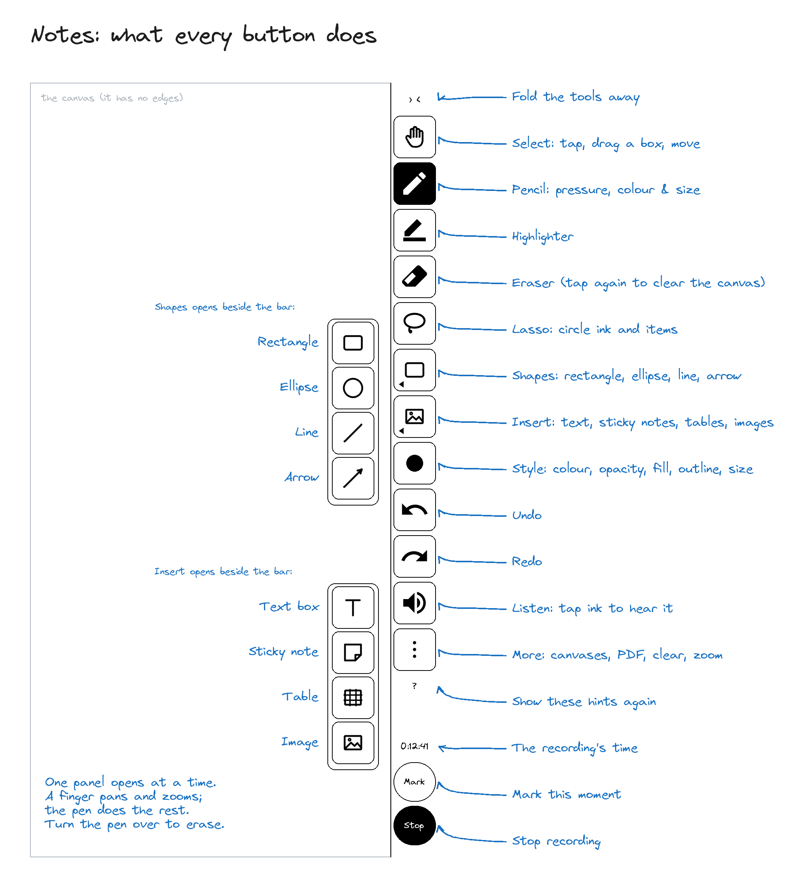

<p align="center">
  <picture>
    <source media="(prefers-color-scheme: dark)" srcset=".github/assets/meetings-icon-dark.png">
    
  </picture>
</p>

<h1 align="center">Meetings</h1>

<p align="center">
  <strong>Record meetings on your e-ink tablet (Supernote, Musnap, Viwoods), then turn them into a transcript, a summary and a to-do list.</strong>
</p>

<p align="center">
  <a href="https://github.com/j-raghavan/sn-meeting/actions/workflows/ci.yml"></a>
  
  
  <a href="./LICENSE"></a>
</p>

---

I wanted my Supernote to record a meeting and hand me back a transcript, a summary and the to-dos, without leaving the device. Meetings is the Android app I built for that. It started on my Supernote Manta, and now runs on my Musnap Aura C too; both are Android e-ink tablets, as is the Viwoods AI Paper. Plug in a USB microphone, connect a Bluetooth headset, or use the tablet's own microphone, and tap **＋ New**. It records in the background while you take notes in another app. Afterwards it transcribes the recording, summarises it with a template you choose, and keeps every open to-do from every meeting on its home screen.

I built it the same way as [inkread](https://github.com/j-raghavan/inkread): a small Kotlin shell for the Android parts, around a Rust core that does everything else and that I can test on my laptop without the device.

## Why Meetings?

- **A meeting recorder that suits e-ink.** It is black on white with no animations, and it shows explicit cues ("SCROLL FOR MORE ↓") instead of motion. I gave it the same look as inkread.
- **Your audio stays a file you own.** Recordings, transcripts and to-dos are plain files in `EXPORT/sn-meeting`, which Supernote Partner (or whatever sync your tablet uses) copies to your computer. There is no database and no lock-in.
- **Bring your own AI provider.** Transcribe with OpenAI or Google Gemini, and summarise with OpenAI, Gemini or Anthropic. Meetings reuses the API keys you already keep on the device for SN-Copilot, so there's no second place to paste them.
- **Built to survive real meetings.** Long recordings are split into 15-minute segments, so a crash loses at most one segment. Unplugging the mic ends the recording cleanly and keeps the audio. A crashed recording is recovered the next time the app opens.

## Status

Meetings is at **v0.1**. Everything below works, and CI checks it on every pull request. On my Supernote A5 X2 Manta I've tested recording, transcription and summaries, recovery after a crash, and unplugging the mic mid-recording. I've also recorded a 20-minute meeting with the screen asleep for most of it: it carried on recording, rolled over into a second segment with no gap, and both segments came out as clean audio.

On my Musnap Aura C I've tested recording from its built-in microphones, transcription and summaries, and writing notes with its fast pen, in colour.

### Tablets

Each e-ink tablet has its own way of drawing the pen quickly and its own screen, so Meetings looks at what the tablet offers rather than its brand:

| Tablet | Pen | Screen | Microphone |
|---|---|---|---|
| **Supernote** (A5 X2 Manta, Nomad) | Supernote's own pen engine | black and white | USB, then Bluetooth (the Manta's built-in microphone records only noise) |
| **Musnap Aura C** | the system hand-write of its iReader platform | colour | its built-in microphones, or Bluetooth (its kernel has no USB audio) |
| **Viwoods AI Paper** and other Android e-ink tablets | standard Android drawing | as the tablet reports it | USB, then Bluetooth, then built-in |

Buttons, panels and text are sized from each screen's density, so they come out the same physical size on an 8.2" tablet and a 10.65" one. On a colour screen the style colours show as colours; on a black-and-white one each is its own grey.

### Roadmap

Here's what I'm building next:

- **v1.1:** a follow-along transcript. Words highlight in step with playback, and you tap a line to jump there.
- **v2:** handwritten notes synced to the audio. Each meeting gets an infinite canvas, with your ink lighting up as the recording plays. The tools (pen, highlighter, eraser, lasso, undo, redo) sit in a docked bar, as in inkread.

## Quick start

1. **Install.** Download `meetings-<version>.apk` from [Releases](https://github.com/j-raghavan/sn-meeting/releases) and sideload it (`adb install -r meetings-<version>.apk`). Releases are signed with the Meetings release key, so after that Meetings updates itself: it checks for a newer release when it opens (at most every 6 hours) and offers to install it. A copy you build yourself is signed with your own debug key and can't update itself.
2. **Add a key.** Meetings reads keys from SN-Copilot's key files in `MyStyle/SnCopilot/`, for example `copilot-key-openai.txt`:
   ```
   provider=openai
   key=sk-...
   model=gpt-4o-mini
   ```
   The same format works for `copilot-key-gemini.txt` and `copilot-key-anthropic.txt`. Meetings never writes to these files and never shows the key.
3. **Allow access.** On first launch, grant **All files access**, so Meetings can save to `EXPORT/sn-meeting`. It asks for the microphone the first time you record.
4. **Record.** Plug in a USB microphone (or use a Bluetooth headset, or the tablet's own microphone) and tap **＋ New**. Tap **■ Stop** when the meeting ends.
5. **Transcribe.** Open the meeting and tap **Transcribe**. Meetings transcribes it, then summarises it with the meeting's template.

On my Manta the built-in microphone records only noise, so there I use a USB microphone or a Bluetooth headset. On my Musnap the built-in microphones record clean audio. The Manta's USB-C port can't take a computer and a USB microphone at the same time, so I develop over adb on Wi-Fi (see Building).

## Using Meetings

### Home
Your five most recent meetings and every open to-do sit side by side. Tick a to-do to close it. The gear opens Settings.

### Recording
- **USB first, then Bluetooth, then the tablet's built-in microphone,** or the microphone you choose in Settings. USB and the built-in microphone record at 44.1 kHz where the tablet allows it; Bluetooth headsets record at 16 kHz. The meeting's Minutes say which kind it was.
- Recording continues with the screen off or another app open. A notification shows the elapsed time and a Stop button.
- If the microphone is unplugged or the headset drops out, the recording stops, keeps what it captured, and notes "mic disconnected".

### Writing notes
I wanted to write while I listen, and later tap a line of my handwriting to hear what was being said as I wrote it. A tablet's own notes app can't tell me when a stroke was written, so I write on the meeting's own page in Meetings. Every stroke I write while recording carries its time on the recording.

- **Notes | Minutes.** The meeting page has two tabs. A meeting I'm recording opens on **Notes**; an earlier one opens on **Minutes**. While recording, the top right shows the timer.
- **The canvas has no edges.** I write with the pen. A finger never draws: I drag with one finger to move around and pinch to zoom from 5% to 2000%. The pill at the top left has **Fit**, **100%**, **50%** and **25%**, and **MAP** opens the minimap, which shows all my ink and where I am; I tap it, or drag its rectangle, to go there. A resting palm leaves no mark.
- **The tool bar** sits on the right edge (or the left, in Settings → Notes) and never covers the page:

  

  - **Select** taps a stroke or a shape to select it (its group comes with it), drags a box on empty page to select everything it touches, and drags the selection to move it. One thing selected shows handles to resize and rotate it (a line or arrow shows its two ends).
  - **Pen** writes with the tablet's own fast pen (Supernote's pen engine on the Manta, the system hand-write on the Musnap), so it keeps up like native notes, in the colour and size of the current style, as wide as I press. Turning the pen over erases, whatever tool is chosen.
  - **Highlighter** draws a light band. **Eraser** removes whole strokes and shapes it touches; tapping **Eraser** again offers **Clear canvas**, which asks first, and **Undo** brings everything back. **Lasso** circles ink (and shapes inside the loop) so I can drag it somewhere else.
  - **Shapes ▸** opens rectangle, ellipse, line and arrow beside the bar; I drag with the pen to draw one. An arrow drawn from or to a shape stays attached and follows it.
  - **Insert ▸** opens text box, sticky note, table and image. A pen tap places a text box or note and opens the keyboard; a drag outlines a table (up to 12 × 8), and a tap on a cell types into it. **Image** lists the PNG, JPG and WebP files in Pictures, Download, INBOX, SCREENSHOT and EXPORT; the picture is copied beside the meeting.
  - **Style ●** opens the colours (twelve: true colour on a colour screen like the Musnap's, each its own grey on a black-and-white one, and true colour in the PDF), opacity, fill, outline and size. A pick restyles what is selected and becomes the default.
  - With something selected, the middle of the bar shows its actions instead: **Delete**, **Duplicate**, **Group** or **Ungroup**, **Front**, **Back**, **Link** (to another meeting: a chain badge appears, and tapping it opens that meeting), **Style**, **Table** (add or remove the row or column I am in) and **Done**.
  - **Undo** and **Redo** step back and forward through strokes and shapes alike; each gesture is one step.
  - **Listen** (the speaker) is for afterwards: with it chosen, tapping my ink, a shape or a text box, with the pen or a finger, plays the recording from two seconds before I wrote it, and the transcript strip shows the line being said. It is off while recording.
  - **⋮** has front and back, zoom to fit or 100 %, **Clear canvas** (and **Restore cleared canvas**, even after a restart), **New canvas** (a fresh page in the same meeting), **Canvases…**, **Export to PDF** (`<meeting>.notes.pdf`, one page per canvas, in colour), Focus (hides the strip) and a full refresh of the screen. **?** shows the hints again.
  - **› ‹** folds the bar into a thin strip that keeps the timer, **Mark** and **Stop**; the choice sticks for every meeting.
  - **Mark** stamps the moment and puts a small ◆ beside my last stroke; marks show in the transcript and go with the minutes. **Stop** ends the recording.
- Panels open beside the bar, one at a time, and the pen never inks on them. A finger only ever pans and zooms.
- **The strip** along the bottom shows the last three lines of the transcript as they arrive, about twice a minute. Tapping it opens the whole transcript over the lower half; tapping again closes it.
- **The Minutes tab** fills in once, when I stop: the summary, the decisions and the to-dos, from the transcript, my marks and (if I agree the first time) images of my handwriting and the text I typed on the canvas. Pictures I insert are never sent. I can tap the summary, a decision or a section to correct it, and my corrections survive **Summarise again**. At the end there is space to write on the minutes themselves.
- An empty page opens with hand-drawn hints pointing at each control; touching the page or choosing a tool puts them away.
- My ink is saved beside the meeting in `<meeting>.notes/` (shapes, text and the paint order in `items.json`, extra canvases in `canvas-2/` and on), so Partner syncs it with everything else. Nothing the AI returns ever changes it. Typed text is searchable straight away, at the moment I typed it.

### Transcripts, summaries and to-dos
- **Transcribe** picks a transcription model your account can use, and stores each segment's text as it arrives. A cancelled or interrupted job resumes where it stopped.
- **Summarise again** re-runs the summary with the current template. To-dos you have ticked stay ticked, even if the model rewords them. **Transcribe again** redoes the transcript.
- Each meeting gets a title, a summary, its decisions, the template's sections and its to-dos, written to `<meeting>.transcript.md` beside the audio.

### Templates
Six built-in templates shape what the summary asks for and how the transcript file reads: General meeting, Stand-up, 1:1, Client call, Interview, and Lecture / talk notes. Edit one in the app, or as a file in `MyStyle/Meetings/templates/` on your computer. **Reset** brings back the original.

### Settings
Settings covers the microphone, the save folder, the transcription and summary providers (each with **Test connection**), the default template, and updates.

### Updates
**Settings → About → Check now** looks for a newer release on GitHub. When there is one, you see its notes and choose **Install**, **Skip this version** or **Later**. Install downloads the APK, checks it against the published SHA-256 and checks that it is signed with the same key as the installed app, then hands it to Android, which asks you to confirm. Android may first ask you to allow Meetings to install apps.

Two switches sit below: **Check for updates automatically** (on by default) and **Install updates automatically** (off by default; Android still asks you to confirm). Meetings never checks, downloads or installs while it is recording or transcribing, because installing restarts the app.

### Your files
For each meeting, in `EXPORT/sn-meeting` (or the folder you choose):

| File | What it is |
|---|---|
| `meeting-YYYYMMDD-HHMMSS-01.m4a` | the audio, one file per segment of up to 15 minutes |
| `meeting-YYYYMMDD-HHMMSS.json` | the meeting's details, transcript text and to-dos |
| `meeting-YYYYMMDD-HHMMSS.transcript.md` | the readable transcript and summary |

### Privacy
Audio is sent only to the transcription provider you choose, and transcripts only to the summary provider. This happens only when you tap Transcribe or Summarise. The first time, Meetings names the providers before anything is sent. Keys never leave the Rust core and never appear in logs or files. The update check asks GitHub for the latest release and sends nothing about your meetings; you can turn it off in Settings.

## Architecture

```
Kotlin shell (app/)          recording service, microphones, screens, in-app updates (GitHub Releases, HTTPS)
        │ JNI (JSON strings; never a key)
Rust core (meeting-core/)    keys, settings, meeting library, providers (rig-core), templates (minijinja)
        │ HTTPS (rustls, bundled roots, no redirects)
OpenAI · Google Gemini · Anthropic
```

The core builds and tests on a laptop, and its provider calls are tested against local mock servers. I keep the Android-only parts thin and check them on the device.

## Building

You need Rust 1.95.0 (pinned in `rust-toolchain.toml`), `cargo-ndk`, the Android NDK, and JDK 21.

```bash
./scripts/quick-check.sh              # before a push: fmt, clippy, the tests that matter, commit messages
./scripts/gates.sh                    # fmt, clippy, tests, coverage ≥ 97 %, lint, JVM tests, script checks
./buildApk.sh                         # gates, then the Rust core for arm64, then the APK
./buildApk.sh --install --device 10.0.0.22:5555
```

I run `quick-check.sh` before every push; `git config core.hooksPath .githooks` makes `git push` run it for me. It compiles every test and runs the core's unit tests, the contract and leak tests, the tests that use what I changed, the Kotlin tests when the app changed, and the same commit-message rules as the pull-request check. CI then runs the whole suite with coverage and lint on every push.

`buildApk.sh --help` explains adb over Wi-Fi. The install step refuses to run while a recording is in progress.

A local build is signed with the debug key unless `MEETINGS_KEYSTORE_FILE`, `MEETINGS_KEYSTORE_PASSWORD`, `MEETINGS_KEY_ALIAS` and `MEETINGS_KEY_PASSWORD` are set. Pushing a `v*` tag runs `.github/workflows/release.yml`, which builds the APK signed with the release key and publishes `meetings-<tag>.apk` and its `.sha256` as a GitHub Release.

## Contributing

Pull requests are welcome. Every pull request runs the full gates in CI, along with a commit check: subjects reference a requirement (for example `F5-FR2: …`) and carry no AI attribution. See the pull request template.

## About & disclaimer

Meetings is my own independent project. It is not affiliated with or endorsed by Ratta (Supernote), Musnap, iReader, Viwoods, OpenAI, Google or Anthropic. You use your own API keys and are bound by each provider's terms; providers may retain the audio and text you send them under their own policies.

## License

[AGPL-3.0-only](./LICENSE). Third-party notices are in [LICENSES-3RDPARTY.md](./LICENSES-3RDPARTY.md).
